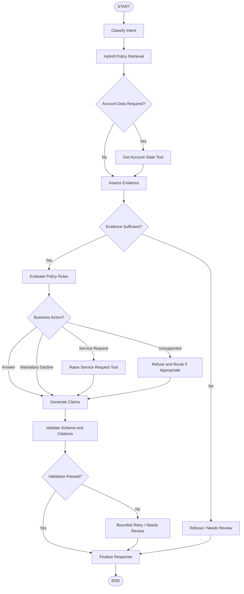

# Architecture Diagram

The application exposes a banking support workflow through FastAPI. LangGraph
coordinates intent classification, policy retrieval, account tools, deterministic
decisions, service routing, and citation-checked responses.

## Application Architecture

                Customer Question
                       |
                       v
                LangGraph Agent
                       |
             Classify customer intent
                       |
              +--------+--------+
              |                 |
              v                 v
       Need account data?   Need service request?
              |                 |
              v                 v
        account.py         service_request.py
              |                 |
              v                 v
       Account information  Request ID, queue,
                            and SLA
              |                 |
              +--------+--------+
                       |
                       v
                Agent processes
                  tool results
                       |
                       v
                AgentResponse

### LangGraph Execution Flow

The agent combines policy retrieval, account data when needed, deterministic
credit decisions, and service routing to produce a structured, citation-checked
response. Policy and account data are local; Groq provides the hosted chat model.

### Technology Stack Summary

Versions below are the versions resolved in the project environment when this
document was prepared.

| Layer            | Technology            | Version | Purpose                                   |
| ---------------- | --------------------- | ------- | ----------------------------------------- |
| Runtime          | Python                | 3.13    | Application runtime                       |
| API              | FastAPI               | 0.162.0 | HTTP health and chat endpoints            |
| API server       | Uvicorn               | 0.54.0  | Runs the ASGI application                 |
| Workflow         | LangGraph             | 1.2.19  | Conditional banking-agent workflow        |
| LLM integration  | LangChain Groq        | 1.1.3   | Groq chat model integration               |
| Policy retrieval | LangChain Community   | 0.4.2   | BM25 retriever and FAISS vector store     |
| Embeddings       | LangChain HuggingFace | 1.2.3   | Local sentence-transformer integration    |
| Vector search    | FAISS CPU             | 1.15.1  | In-memory local vector index              |
| Embedding model  | Sentence Transformers | 6.2.0   | Creates local policy and query embeddings |
| Validation       | Pydantic              | 2.14.2  | Request, response, and citation schemas   |

### Data Storage & External Services

Policy Markdown files and synthetic account records are read from the local
`data/` directory. At application startup, policy files are chunked and used to
build in-memory BM25 and FAISS indexes; the FAISS index is not a persistent
database. Account lookups read `accounts.json`, and service requests are
simulated in process, returning a generated ID, queue, and SLA. Groq is the
external chat API. Hugging Face may be contacted to download the embedding model
when it is not already cached; embedding and retrieval then run locally. The
application does not use a remote database, cache, or message broker.

### Tool Design and Usage

The tools are local functions invoked by conditional LangGraph nodes rather
than unrestricted tools selected directly by the model.

| Tool | When it runs | Inputs | Behavior and result |
| ---- | ------------ | ------ | ------------------- |
| Account lookup | Only when the classified request requires account data | `customer_id` from the request | Reads the matching synthetic record from `accounts.json`. A missing customer or unavailable account data moves the workflow to `needs_review`. |
| Service-request routing | When policy evaluation determines that a supported request should be routed | `customer_id`, a supported category, and the customer's question as the summary | Maps the category to a queue and SLA, then returns a generated request ID. The request is simulated in process; it is not submitted to an external service. |

Tool results are added to workflow state and can support response claims only
when their evidence passes citation validation. The model does not choose
arbitrary functions or make credit-limit decisions.

### Key Design Decisions

- LangGraph coordinates explicit workflow stages; credit-limit decisions remain
  deterministic rather than delegated to the LLM.
- Hybrid retrieval combines BM25 and FAISS rankings, then filters
  non-authoritative policy content from normal evidence.
- Response citations are generated by the application and validated against
  retrieved policy, account-tool, or service-tool evidence.
- Account lookups are conditional, limiting access to account data to requests
  that need it.
- Service routing uses a fixed category-to-queue/SLA map so routing behavior is
  predictable and testable.

### Trade-offs and Limitations

- Local policy and account files avoid a remote database dependency, but the
  account records are synthetic and service requests are not persisted or sent
  to a banking system.
- BM25 plus FAISS supports both keyword and semantic matches, at the cost of
  building and keeping both indexes in memory at startup. The FAISS index is
  rebuilt from the local policy corpus and is not persistent.
- Embeddings and retrieval run locally after the model is available, but the
  initial embedding-model download may need Hugging Face access. Intent
  classification and response generation require the hosted Groq API, so
  network availability and provider rate limits affect those requests.
- Citation and schema checks constrain generated responses to available
  evidence, but they cannot compensate for missing, stale, or incorrect source
  policy data. Insufficient evidence is routed to refusal or review rather than
  guessed.

### Component Inventory

| Component               | Layer                | Type                        | Responsibility                                                     |
| ----------------------- | -------------------- | --------------------------- | ------------------------------------------------------------------ |
| FastAPI router          | Presentation         | HTTP routes                 | Accepts `/chat` and `/health` requests                             |
| Pydantic schemas        | Presentation         | Request and response models | Validates request fields and response shape                        |
| LangGraph workflow      | Workflow             | State graph                 | Coordinates classification, retrieval, tools, policy, and response |
| Intent classifier       | Workflow             | Groq structured-output call | Selects intent and identifies account-data need                    |
| Evidence assessment     | Workflow             | Deterministic graph node    | Ensures required authoritative policy documents were retrieved     |
| Account lookup          | Workflow and data    | Local tool                  | Loads a synthetic customer record from JSON                        |
| Credit policy rules     | Business logic       | Deterministic evaluator     | Applies limit-increase eligibility and mandatory-decline rules     |
| Service request routing | Workflow and data    | Local tool                  | Maps supported request categories to queue and SLA                 |
| Policy ingestion        | Retrieval            | Markdown parser and chunker | Extracts metadata and sections from policy documents               |
| PolicyRetriever         | Retrieval            | Hybrid search component     | Fuses BM25 and FAISS rankings                                      |
| BM25 retriever          | Retrieval            | Keyword index               | Finds lexical policy matches                                       |
| FAISS vector store      | Retrieval            | In-memory vector index      | Finds semantically similar policy chunks                           |
| Sentence embeddings     | Retrieval            | Local model integration     | Encodes policy chunks and search queries                           |
| Response builder        | Workflow             | Response generator          | Produces structured outcomes and application-created citations     |
| Citation validator      | Validation           | Evidence validator          | Checks citations against policy, account, and service results      |
| Groq chat model         | External integration | Hosted LLM API              | Classifies requests and drafts evidence-grounded claims            |
| Policy Markdown         | Local data           | Source documents            | Supplies policy evidence and document metadata                     |
| `accounts.json`         | Local data           | Synthetic account dataset   | Supplies customer state to the account lookup tool                 |
